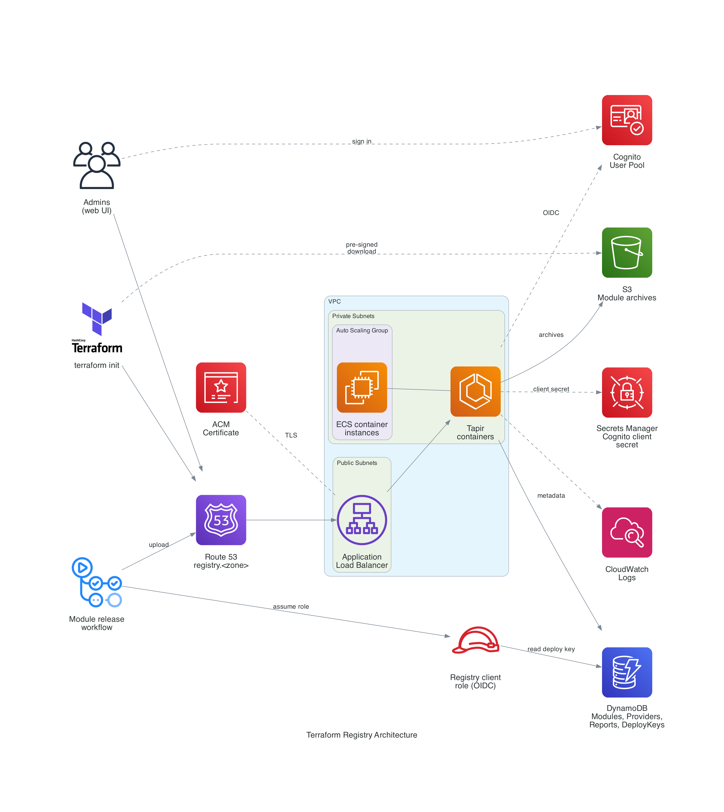

# Architecture

## Component Overview

| Component | Created by | Purpose |
|-----------|------------|---------|
| Application Load Balancer, ACM certificate, Route 53 record | [infrahouse/ecs/aws](https://github.com/infrahouse/terraform-aws-ecs) | HTTPS entry point at `<registry_hostname>.<zone>` |
| ECS cluster, service, and Auto Scaling group | [infrahouse/ecs/aws](https://github.com/infrahouse/terraform-aws-ecs) | Runs the `pacovk/tapir:0.7.0` container |
| Cognito user pool, domain, app client, `admin` group | this module | Sign-in for the web UI |
| Secrets Manager secret | [infrahouse/secret/aws](https://github.com/infrahouse/terraform-aws-secret) | Holds the Cognito app client secret |
| S3 bucket `terraform-registry-*` | [infrahouse/s3-bucket/aws](https://github.com/infrahouse/terraform-aws-s3-bucket) | Module archives |
| S3 bucket `terraform-registry--replica*` | [infrahouse/s3-bucket/aws](https://github.com/infrahouse/terraform-aws-s3-bucket) | Replica of the archives in `replication_region` |
| DynamoDB tables | this module | `Modules`, `Providers`, `Reports`, `DeployKeys` |
| IAM role `registry-node-*` | this module | Task role: the Tapir container's access to the tables and the bucket |
| IAM roles `ih-tf-<repo>-github` | [infrahouse/github-role/aws](https://github.com/infrahouse/terraform-aws-github-role) | One per `terraform_modules` entry, for publishing from GitHub Actions |
| CloudWatch log group `/ecs/<environment>/<service_name>` | [infrahouse/ecs/aws](https://github.com/infrahouse/terraform-aws-ecs) | Tapir container logs, kept 365 days |

## Signing In to the Web UI

1. A browser opens `https://registry.example.com`.
2. Tapir has no session for it and redirects to the Cognito hosted UI at
   `https://<service_name>-<region>.auth.<region>.amazoncognito.com`.
3. The user signs in with their email and password. On the first sign-in Cognito makes them replace the
   temporary password.
4. Cognito redirects back to the registry URL with an authorization code. Tapir exchanges the code for tokens,
   authenticating itself with the app client secret.
5. Tapir reads the `cognito:groups` claim from the ID token. Members of `admin` get the admin UI.

Tapir is a Quarkus application, so the module configures sign-in through environment variables:

| Variable | Value |
|----------|-------|
| `AUTH_ENDPOINT` | The user pool's issuer URL, `https://cognito-idp.<region>.amazonaws.com/<pool id>` |
| `AUTH_CLIENT_ID` | The app client ID |
| `AUTH_CLIENT_SECRET` | The app client secret, injected by ECS from Secrets Manager |
| `AUTH_ROLE_SOURCE`, `QUARKUS_OIDC_ROLES_SOURCE` | `idtoken` — take roles from the ID token |
| `QUARKUS_OIDC_ROLES_ROLE_CLAIM_PATH` | `cognito:groups` |
| `QUARKUS_OIDC_AUTHENTICATION_FORCE_REDIRECT_HTTPS_SCHEME` | `true` — TLS ends at the ALB, the container sees HTTP |

ID and access tokens are valid for 60 minutes and refresh tokens for 30 days.

## Downloading Modules

1. `terraform init` reads `https://registry.example.com/.well-known/terraform.json` to find the modules API.
2. It lists versions at `/terraform/modules/v1/<namespace>/<name>/<provider>/versions`. Tapir answers from
   the `Modules` table.
3. It requests `/terraform/modules/v1/<namespace>/<name>/<provider>/<version>/download`. Tapir replies with
   `204 No Content` and an `X-Terraform-Get` header holding a pre-signed S3 URL.
4. Terraform downloads the archive directly from S3.

None of these requests needs a sign-in, so module archives never pass through the Tapir containers on the way
down.

## Publishing Modules

1. An admin creates a deploy key for `<namespace>/<name>/<provider>` in the Tapir UI. Tapir stores it in the
   `DeployKeys` table under the ID `<namespace>-<name>-<provider>`.
2. A release workflow in the module repository assumes the repository's registry client role through GitHub
   OIDC. The role allows `dynamodb:GetItem` on the `DeployKeys` table and nothing else.
3. `ih-registry upload` reads the deploy key, zips the repository, and posts the zip to
   `/terraform/modules/v1/<namespace>/<name>/<provider>/<version>` with the key in the `x-api-key` header.
4. Tapir checks the key, writes the archive to S3, and records the version in the `Modules` table.

## Compute

The ECS service runs between `task_min_count` (2) and `task_max_count` (10) Tapir tasks, each with 256 MB of
memory. The container instances come from the latest Amazon Linux 2 ECS-optimized AMI (x86_64) and run in
`subnets_backend`. `on_demand_base_capacity` sets how many of them must be on-demand.

## Health Checks

Tapir does not expose a health endpoint. Every unauthenticated request gets a `302` redirect to Cognito, so the
ALB treats `302` as healthy. Inside the container, ECS checks that the Java process is alive with
`pkill -0 java`.

## Storage

- **S3** holds the module archives under `<namespace>/<name>/<provider>/<version>.zip`. The bucket comes from
  [infrahouse/s3-bucket/aws](https://github.com/infrahouse/terraform-aws-s3-bucket), which turns on encryption,
  versioning, and blocks public access. It replicates every new archive to a bucket in `replication_region`,
  so a regional outage or a deleted bucket doesn't lose what was published.
- **DynamoDB** holds everything else. The tables use on-demand capacity and have point-in-time recovery on, so
  the `DeployKeys` and `Modules` tables can be restored to any second in the last 35 days.
